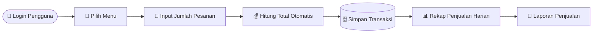
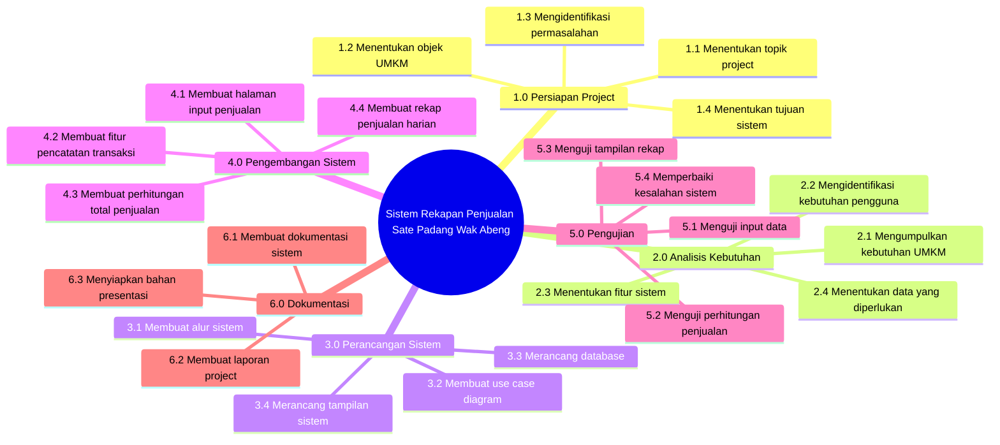
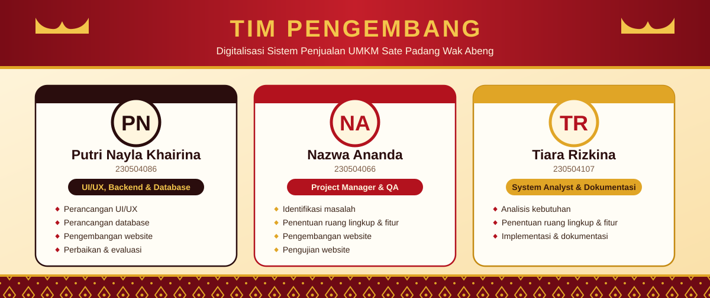

# 🍢 Digitalisasi Sistem Penjualan dan Pengelolaan UMKM Sate Padang Wak Abeng

**Mata Kuliah:** Manajemen Proyek Perangkat Lunak (MPPL) &nbsp;|&nbsp; **Kelompok:** 7 &nbsp;|&nbsp; **Tahun:** 2026
 
**Dosen Pengampu:** Cut Alna Fadhilla, M.Sc.

---

## 🍢 Studi Kasus UMKM

| | |
|---|---|
| **Nama UMKM** | Sate Padang Wak Abeng |
| **Jenis Usaha** | Kuliner |
| **Produk Utama** | Sate Padang dan makanan/minuman pendamping |
| **Nama Proyek** | Sistem Rekapan Penjualan Harian UMKM Sate Padang Wak Abeng |

Sate Padang Wak Abeng melakukan kegiatan penjualan makanan setiap hari. Proses pencatatan transaksi, pengelolaan menu, dan pemantauan penjualan masih dapat dikembangkan dengan teknologi informasi. Proyek ini menghasilkan sistem yang membantu pemilik dan karyawan mengelola informasi menu, transaksi, dan laporan penjualan secara lebih terstruktur.

---

## 📌 Latar Belakang & Permasalahan

Transaksi yang terjadi setiap hari perlu direkap secara teratur agar pemilik mengetahui jumlah penjualan dan pendapatan harian. Kondisi saat ini menimbulkan beberapa kendala:

- ❌ **Pencatatan Manual:** Penjualan masih dicatat secara manual sehingga rentan salah catat.
- ❌ **Rekap Sulit:** Data penjualan harian sulit direkap saat jumlah transaksi banyak.
- ❌ **Informasi Terlambat:** Pemilik membutuhkan total penjualan setiap hari, tetapi belum tersedia secara cepat.
- ❌ **Arsip Tidak Terstruktur:** Data penjualan belum tersimpan rapi sebagai bahan evaluasi.

---

## 🎯 Tujuan Proyek

1. Mengembangkan sistem digital untuk membantu proses penjualan UMKM.
2. Mempermudah pencatatan transaksi penjualan.
3. Menyediakan informasi laporan penjualan.
4. Mengurangi ketergantungan terhadap pencatatan manual.
5. Menyediakan rekapan penjualan harian.

---

## 🔄 Alur Sistem (Workflow)

---

## 🧭 Ruang Lingkup Proyek (Scope)

| 🟢 IN SCOPE | 🔴 OUT OF SCOPE |
|---|---|
| Pencatatan transaksi penjualan | Pengelolaan keuangan pribadi pemilik |
| Pengelolaan data menu dan harga | Integrasi dengan sistem perbankan |
| Pencatatan nama/jenis menu, jumlah, harga, dan total transaksi | Pengelolaan pajak |
| Rekap total penjualan harian | Pengadaan perangkat keras baru |
| Penyimpanan data penjualan | |
| Laporan penjualan dan dashboard ringkasan | |

### 🎁 Deliverables

- [ ] Dokumen kebutuhan sistem
- [ ] Desain sistem
- [ ] Database
- [ ] Modul pengelolaan menu
- [ ] Modul transaksi
- [ ] Modul laporan
- [ ] Dokumentasi sistem
- [ ] Hasil pengujian
- [ ] Sistem siap digunakan

### ⚖️ Triple Constraint

| Constraint | Rencana |
|---|---|
| **Scope** | Pengembangan sistem transaksi dan laporan penjualan |
| **Time** | Diselesaikan sesuai batas waktu proyek/perkuliahan |
| **Cost** | Mengutamakan software dan tools yang tersedia/gratis |

---

## 👥 Stakeholder

| No | Stakeholder | Peran | Keterlibatan |
|:-:|---|---|---|
| 1 | 🧑‍🍳 Pemilik Sate Padang Wak Abeng | Pemilik dan pemberi kebutuhan sistem | Tinggi (langsung) |
| 2 | 🧑‍💼 Karyawan | Pengguna sistem | Tinggi (langsung) |
| 3 | 💻 Tim Pengembang | Membuat dan mengembangkan sistem | Tinggi (langsung) |
| 4 | 🎓 Dosen / Pembimbing | Memberikan arahan dan evaluasi | Sedang |
| 5 | 🍽️ Pelanggan | Pengguna tidak langsung | Rendah (tidak langsung) |

---

## 🗂️ Work Breakdown Structure (WBS)

<b>📋 Lihat WBS dalam bentuk tabel</b>

| Kode | Tahapan / Sub Kegiatan |
|:-:|---|
| **1.0** | **Persiapan Project** |
| 1.1 | Menentukan topik project |
| 1.2 | Menentukan objek UMKM |
| 1.3 | Mengidentifikasi permasalahan |
| 1.4 | Menentukan tujuan sistem |
| **2.0** | **Analisis Kebutuhan** |
| 2.1 | Mengumpulkan kebutuhan UMKM |
| 2.2 | Mengidentifikasi kebutuhan pengguna |
| 2.3 | Menentukan fitur sistem |
| 2.4 | Menentukan data yang diperlukan |
| **3.0** | **Perancangan Sistem** |
| 3.1 | Membuat alur sistem |
| 3.2 | Membuat use case diagram |
| 3.3 | Merancang database |
| 3.4 | Merancang tampilan sistem |
| **4.0** | **Pengembangan Sistem** |
| 4.1 | Membuat halaman input penjualan |
| 4.2 | Membuat fitur pencatatan transaksi |
| 4.3 | Membuat perhitungan total penjualan |
| 4.4 | Membuat rekap penjualan harian |
| **5.0** | **Pengujian** |
| 5.1 | Menguji input data |
| 5.2 | Menguji perhitungan penjualan |
| 5.3 | Menguji tampilan rekap |
| 5.4 | Memperbaiki kesalahan sistem |
| **6.0** | **Dokumentasi** |
| 6.1 | Membuat dokumentasi sistem |
| 6.2 | Membuat laporan project |
| 6.3 | Menyiapkan bahan presentasi |

---

## ⚠️ Risiko Awal

| Risiko | Dampak | Respons |
|---|---|---|
| Kebutuhan sistem berubah | Pekerjaan bertambah | Konfirmasi kebutuhan sejak awal |
| Data UMKM tidak lengkap | Sistem sulit dikembangkan | Wawancara dan pengumpulan data |
| Pengguna belum terbiasa | Sistem kurang dimanfaatkan | Memberikan pelatihan |
| Keterlambatan pengerjaan | Deadline tidak tercapai | Membuat jadwal dan monitoring |
| Kesalahan sistem | Data/transaksi tidak sesuai | Pengujian sebelum implementasi |

---

## ✅ Kriteria Keberhasilan

- Sistem selesai sesuai scope yang disepakati
- Sistem dapat digunakan oleh pemilik/karyawan
- Transaksi dapat dicatat dengan baik
- Data menu dapat dikelola
- Laporan penjualan dapat dihasilkan
- Pengguna memahami cara menggunakan sistem
- Proyek memenuhi batas waktu dan biaya yang ditentukan

---

## 👨‍👩‍👧 Tim Pengembang (Kelompok 7)

| Nama | NIM | Peran |
|---|---|---|
| Putri Nayla Khairina | 230504086 | UI/UX, Backend & Database Developer |
| Nazwa Ananda | 230504066 | Project Manager & QA |
| Tiara Rizkina | 230504107 | System Analyst & Dokumentasi |

### 📋 Pembagian Tugas

| No | Aktivitas | Penanggung Jawab |
|:-:|---|---|
| 1 | Identifikasi Masalah | Nazwa Ananda |
| 2 | Analisis Kebutuhan | Tiara Rizkina |
| 3 | Penentuan Ruang Lingkup dan Fitur | Tiara Rizkina, Nazwa Ananda |
| 4 | Perancangan UI/UX | Putri Nayla Khairina |
| 5 | Perancangan Database | Putri Nayla Khairina |
| 6 | Pengembangan Website | Nazwa Ananda, Putri Nayla Khairina |
| 7 | Pengujian Website | Nazwa Ananda |
| 8 | Perbaikan dan Evaluasi | Putri Nayla Khairina |
| 9 | Implementasi dan Dokumentasi | Tiara Rizkina |

### 🧩 Matriks Tanggung Jawab

| Aktivitas | Putri | Nazwa | Tiara |
|---|:-:|:-:|:-:|
| Identifikasi Masalah |  | ✅ |  |
| Analisis Kebutuhan |  |  | ✅ |
| Penentuan Ruang Lingkup dan Fitur |  | ✅ | ✅ |
| Perancangan UI/UX | ✅ |  |  |
| Perancangan Database | ✅ |  |  |
| Pengembangan Website | ✅ | ✅ |  |
| Pengujian Website |  | ✅ |  |
| Perbaikan dan Evaluasi | ✅ |  |  |
| Implementasi dan Dokumentasi |  |  | ✅ |

---

🍢 Dibuat untuk tugas mata kuliah **Manajemen Proyek Perangkat Lunak** · Kelompok 7 · 2026

